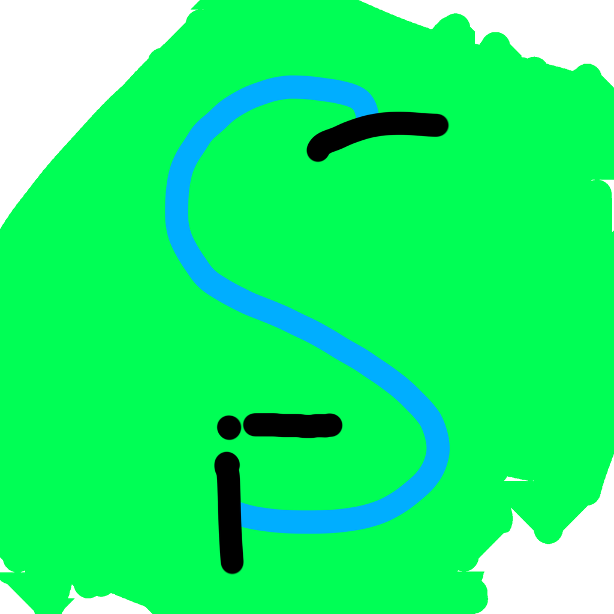

> [!WARNING]
> **⚠️ ARCHIVED — this project is broken and no longer maintained.**
> The maintainers have archived this repository (read-only). The core design
> (a rebranded/re-wrapped Chromium bundle) fought macOS code-signing at every
> step, and the approach was abandoned in favor of lighter bases. The code is
> kept for historical/reference purposes only — do not use it in production.
> See [INFO.md](INFO.md) §0 for the post-mortem.
>
> **License:** GNU General Public License v3.0 (GPLv3) — the Linux-style
> copyleft: if you use, modify, or redistribute this code, your version must
> also be open-sourced under the GPL. See [LICENSE](LICENSE).

<p align="center">
  
</p>

<h1 align="center">SCBrowser</h1>
<p align="center"><b>SimpleChromiumBrowser</b> — a privacy-focused Chromium browser for macOS Apple Silicon, controlled entirely from your terminal. <i>(Archived — see warning above.)</i></p>

<p align="center">
  <a href="#install">Install</a> ·
  <a href="#quick-start">Quick start</a> ·
  <a href="#features">Features</a> ·
  <a href="INFO.md">Deep dive (INFO.md)</a> ·
  <a href="comparison.html">Privacy comparison</a>
</p>

---

SCBrowser is a **separate browser app** built from ungoogled-chromium. It has its
own profile, its own DevTools port, and a bundled privacy extension — and it
never touches your regular Chromium (different profile, different port,
different processes).

Everything is driven by one command:

```bash
scbrowser open https://privacytests.org/
```

## Install

Requirements: macOS on Apple Silicon (arm64), [Homebrew](https://brew.sh), Python 3 (ships with macOS).

```bash
cd ~/SCBrowser
./scripts/install.sh
```

That installs ungoogled-chromium if needed, builds `SCBrowser.app`, puts
`scbrowser` on your PATH, and verifies a cold start. No code signing, no sudo,
no Keychain fiddling.

> **First launch:** always start it with `scbrowser open` (not by double-clicking
> the app in Finder/Dock). That's how it gets its own profile, privacy flags,
> and extension. See [INFO.md](INFO.md) for why.

## Quick start

```bash
scbrowser open https://privacytests.org/   # launch (hidden) + open a tab
scbrowser show                              # bring the window to front anytime
scbrowser hide                              # minimize it again
scbrowser tabs                              # list tabs
scbrowser navigate https://example.com
scbrowser eval 'document.title'             # run JS in the active tab
scbrowser screenshot                        # ~/SCBrowser/screenshot.png
scbrowser mode aggressive                   # or: normal — extension mode
scbrowser status                            # running?, tabs, RAM
scbrowser memory                            # detailed RAM report
scbrowser close                             # quit SCBrowser only
```

Every command is **1 line, non-interactive, no prompts** — safe to script, and
safe for AI agents that need a real browser from the terminal.

## Features

- **Terminal control** — open, navigate, show/hide, screenshot, evaluate JS,
  and switch privacy modes without ever touching the mouse.
- **Hidden window** — launches minimized, stays out of your way, one
  `scbrowser show` brings it back.
- **Privacy Shield extension** — tracker blocking in Normal mode; Aggressive
  mode adds fingerprint spoofing and stricter settings. Switch anytime with
  `scbrowser mode aggressive|normal`.
- **Privacy flags** — WebRTC IP-leak protection, canvas/client-rects noise,
  Do Not Track, no sync, no background networking, no Translate/optimization
  services, and more (`config/privacy-flags.txt`).
- **Fast cold start** — ~6 seconds from `scbrowser close` to a usable tab
  (measured on Apple Silicon; see [INFO.md](INFO.md) for how the signing
  trap was diagnosed and avoided).
- **Passkeys** — real macOS Keychain (Touch ID + iCloud Keychain + QR hybrid),
  no mock keychain.
- **Honest RAM reporting** — `scbrowser memory` reports both RSS and physical
  footprint. Light sites sit well under 400 MB footprint; 1080p YouTube will
  exceed that in any Chromium browser (see INFO.md).
- **Privacy tests** — see [`comparison.html`](comparison.html) for SCBrowser vs.
  the other browsers on the [privacytests.org](https://privacytests.org/) list.

## Updating

```bash
brew upgrade --cask ungoogled-chromium   # new Chromium (currently 156)
cd ~/SCBrowser && ./scripts/build-app.sh # rebuild SCBrowser.app from it
```

Your SCBrowser profile and settings are preserved.

## Uninstall

```bash
scbrowser close
rm -rf ~/SCBrowser "~/Library/Application Support/SCBrowser"
# optional — removes your original Chromium too:
brew uninstall --cask ungoogled-chromium
```

## Docs

- [INFO.md](INFO.md) — the nerdy deep dive: architecture, why the bundle must
  stay byte-identical, the Keychain encryption story, GPU sandbox, cold-start
  diagnosis, flag-by-flag reference, RAM methodology, known limitations
  (GPC/Tor), and troubleshooting.
- `comparison.html` — privacytests.org comparison page.

---

*SCBrowser is a wrapper around ungoogled-chromium, not a Chromium fork.
Chromium and ungoogled-chromium are trademarks of their respective owners.*

## License

GNU General Public License v3.0 — see [LICENSE](LICENSE). Same copyleft family
as the Linux kernel (GPL): use, modify, or redistribute it, and your version
must be open-sourced under the GPL too.
